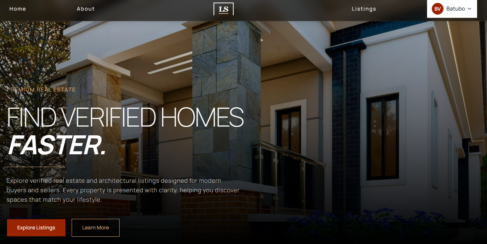
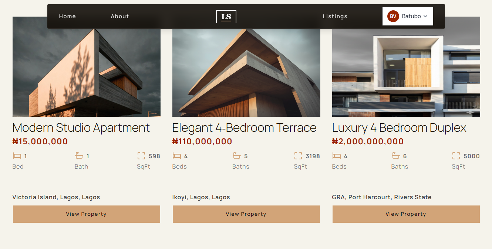
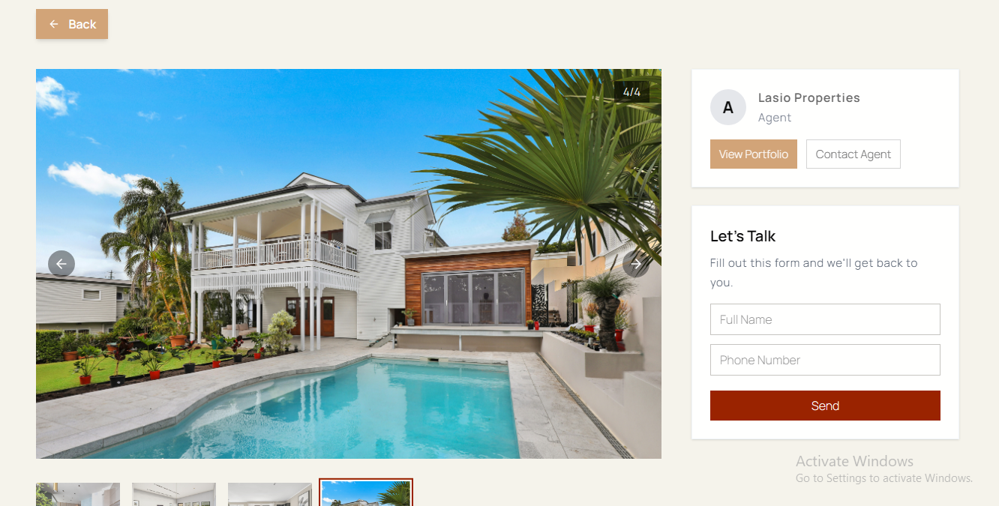
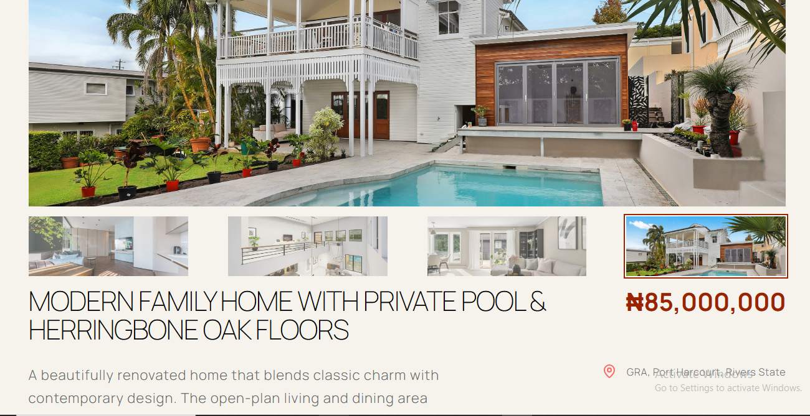
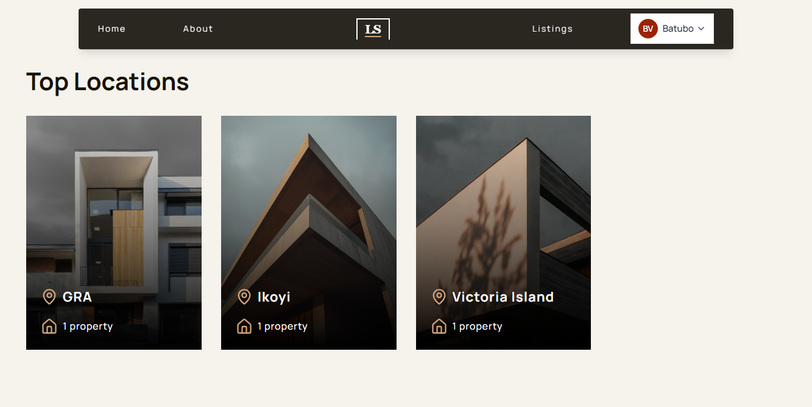
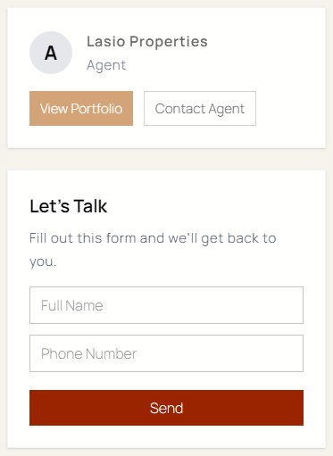
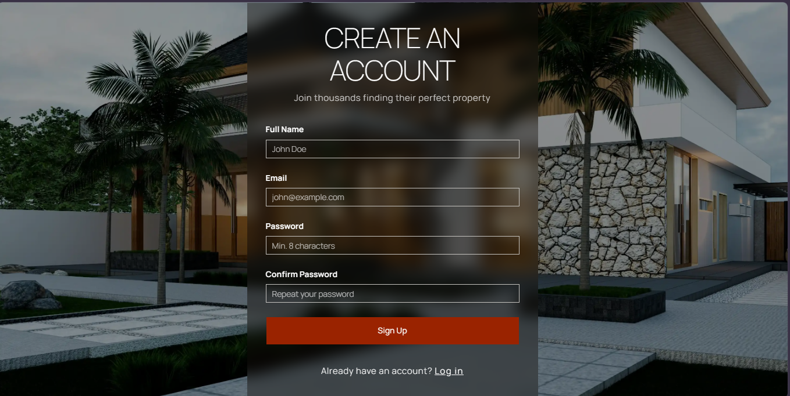
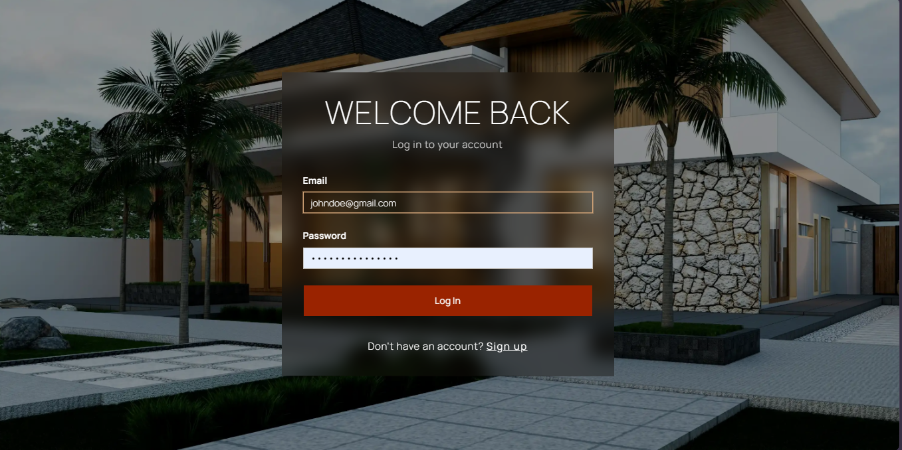
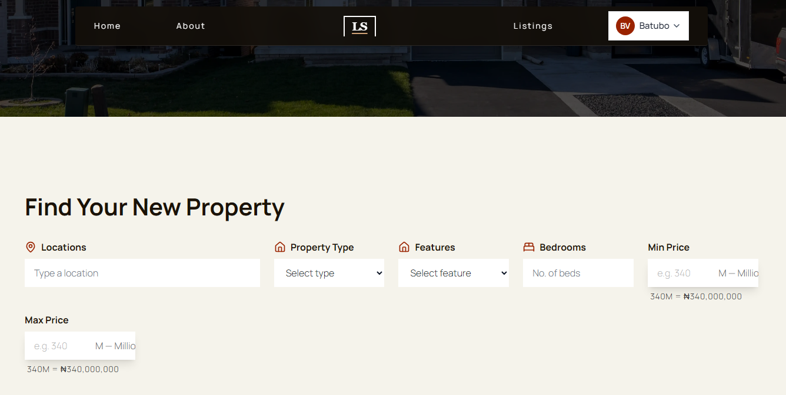

# Lasio — Real Estate Listing & Management Platform

Lasio is a full-stack property listing and management platform designed for real estate agencies. It provides a centralized place for agencies to manage their property listings and showcase available properties to prospective clients through a clean, responsive interface.

The goal is to simplify property management for agencies while making it easier for clients to discover and explore available properties.

## Demo

**Live Application:** [https://lasio.vercel.app/](https://lasio.vercel.app/)

**Demo Video:**  
[INSERT DEMO VIDEO LINK HERE]

## Screenshots

<!-- Replace the placeholders below with links to your screenshots. -->

### Homepage



### Property Listings



### Property Details





### Top Locations



### Agent Card



### Authentication




### Search & Filter



---

## Features

### Property Discovery

- Browse available property listings.
- View property details, including price, location, bedrooms and property type.
- Search and filter available properties.
- Explore property images and listing information.
- Responsive interface for desktop and mobile devices.

### Agency Listing Management

- Create property listings.
- Edit existing listings.
- Delete property listings.
- Upload and manage property images.
- Access an agent dashboard for listing management.

### Authentication & Authorization

- User registration and login.
- JWT-based authentication.
- Role-based access control for agents and administrators.
- Listing ownership verification.
- Protected operations through backend middleware.

Agents can manage their own listings, while the backend enforces authorization before allowing protected operations.

---

## Technology Stack

| Category | Technologies |
|---|---|
| Frontend | React, TypeScript, Vite |
| Styling | Tailwind CSS |
| State Management | Redux |
| Routing | React Router |
| Backend | Node.js, Express.js |
| Database | Supabase / PostgreSQL |
| Authentication | JWT |
| Image Storage | Supabase Storage |
| Frontend Hosting | Vercel |
| Backend Hosting | Render |

---

## Architecture Overview

Lasio uses a separate frontend and backend within the same repository.

The frontend communicates with the Express backend through API requests. The backend handles application logic, authentication, authorization and database operations, while Supabase provides PostgreSQL database services and image storage.

### Frontend

The frontend is built with React and TypeScript.

It is responsible for:
- Rendering the user interface.
- Handling navigation and application views.
- Managing application state with Redux.
- Sending requests to the backend API.
- Displaying property listings and details.
- Providing agent-facing listing management interfaces.

### Backend

The backend is built with Node.js and Express.js and is located in `app/server`.

It handles:
- API routes and request processing.
- Authentication and JWT verification.
- Role-based authorization.
- Listing ownership checks.
- Property listing CRUD operations.
- Communication with Supabase.

The backend uses middleware to verify authenticated users and enforce access permissions before protected operations are executed.

### Database & Storage

Supabase provides the PostgreSQL database and image storage services.

The application uses Supabase's client library to communicate with the database and Supabase Storage for property images.

---

## Authentication & Authorization

Lasio implements JWT-based authentication.

The authentication flow includes:
1. User registration and login.
2. Password hashing and salting before storage.
3. Token-based authentication.
4. Middleware for verifying authenticated requests.
5. Role-based access checks for agents and administrators.
6. Listing ownership verification before protected listing operations.

Authentication and authorization are handled separately:

- **Authentication** verifies the identity of a user.
- **Authorization** determines whether that user is permitted to perform a particular operation.

Protected backend operations use middleware to enforce these checks.

---

## Project Structure

The project contains separate frontend and backend applications.

```text
## Project Structure
Lasio/
├── app/
│   ├── client/                  # React frontend
│   │   └── src/
│   │       ├── components/      # Reusable UI components
│   │       ├── config/          # Frontend configuration
│   │       ├── hooks/           # Custom React hooks
│   │       ├── layouts/         # Application layouts
│   │       ├── pages/           # Application pages
│   │       ├── sections/        # Homepage sections
│   │       ├── selectors/       # Redux selectors
│   │       ├── state/           # Redux store and slices
│   │       ├── types/           # TypeScript types
│   │       └── utils/           # Utility functions
│   │
│   └── server/                  # Node.js / Express backend
│       └── src/
│           ├── config/          # Supabase configuration
│           ├── controllers/     # Request handlers
│           ├── middleware/      # Authentication and authorization
│           ├── routes/          # API routes
│           ├── services/        # Business logic and database operations
│           ├── types/           # Backend TypeScript types
│           ├── utils/           # Helper functions
│           └── __tests__/       # Backend tests
│
├── docs/                        # Project documentation
├── package.json                 # Root project configuration
└── README.md
```

*Note: This is a simplified representation. The actual project structure may contain additional directories and files.*

---

## Installation & Setup

### Prerequisites

- Node.js
- npm
- A Supabase project

### 1. Clone the Repository

```bash
git clone https://github.com/Vicante-Studio/Lasio.git
cd Lasio
```

### 2. Install Dependencies

Install the project dependencies using the appropriate package scripts.

```bash
npm install
```

*If the frontend and backend have separate dependency installations, follow their respective package configurations.*

### 3. Environment Variables

The application requires environment variables for API communication and Supabase integration.

The following variables are used:

```env
VITE_API_URL=
SUPABASE_URL=
SUPABASE_ANON_KEY=
SUPABASE_SERVICE_ROLE_KEY=
```

**Important:** Never commit actual credentials or secret keys to version control.

The Supabase service role key must only be used in the backend environment. It must never be exposed to the browser or included in frontend environment variables.

### 4. Start the Development Server

```bash
npm run dev
```

The frontend and backend development commands may be configured separately depending on the root package scripts.

---

## Engineering Considerations

Some areas of the implementation remain open to improvement, particularly around frontend state synchronization, backend architecture and production reliability.

Known issues include:

- Deleted listings may remain visible in the frontend until the user navigates away or refreshes the page.
- Property images can take a long time to load after periods of inactivity.

These are known areas for further debugging and optimization.

---

## Project Status

Lasio is a working full-stack project with property discovery, listing management, authentication and authorization functionality.

The application has been deployed and tested with external assistance. It is not currently under active maintenance.

---

## What I Learned

Building Lasio provided practical experience with:

- Developing a full-stack application using React, TypeScript and Node.js.
- Designing and implementing REST API functionality.
- Integrating a PostgreSQL database through Supabase.
- Implementing JWT-based authentication.
- Applying middleware for authentication and authorization.
- Managing file uploads with Supabase Storage.
- Connecting frontend state management with backend API operations.
- Deploying frontend and backend applications.

---

## Author

**Built by Vicante Studio**

Lasio was developed as a real estate technology project focused on helping agencies manage property listings and improve how clients discover available properties.

---

## License

This project is licensed under the MIT License. See the [LICENSE](LICENSE) file for details.
